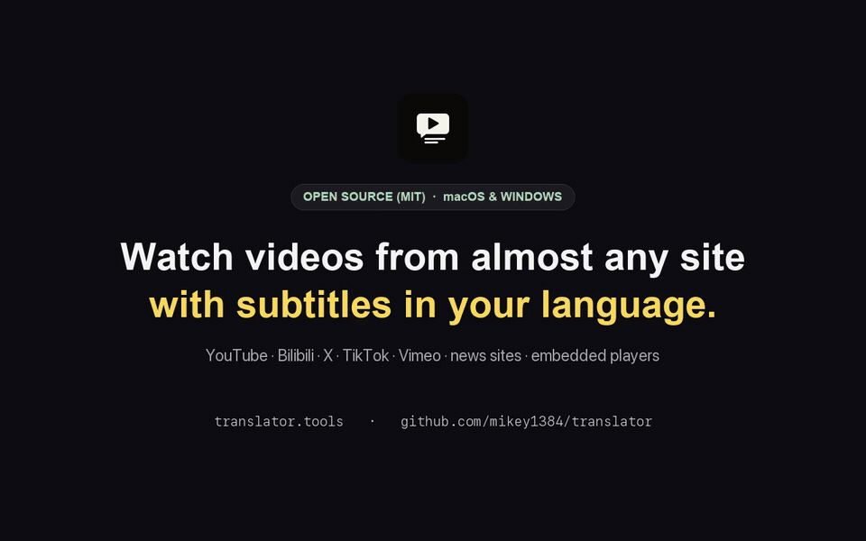

<p align="center">
  <a href="https://translator.tools">
    
  </a>
</p>

<h1 align="center">Translator</h1>

<p align="center">
  <strong>Paste a video link from almost any website and watch it with subtitles in your language.</strong>
</p>

<p align="center">
  Open-source desktop app for macOS and Windows. Download from YouTube, Bilibili, X, TikTok, Vimeo, news sites, and embedded players — then transcribe, translate into 39 languages, edit, dub, or export in one place.
</p>

<p align="center">
  <a href="https://translator.tools/#all-downloads"><strong>Download for Mac &amp; Windows</strong></a>
  ·
  <a href="https://translator.tools/agents">Claude, Codex &amp; Gemini MCP</a>
  ·
  <a href="https://translator.tools/pricing">Pricing</a>
  ·
  <a href="https://translator.tools/faq">FAQ</a>
</p>

<p align="center">
  
  
  
  
  
</p>



## Quick install

Download a signed installer from **[translator.tools](https://translator.tools/#all-downloads)** (macOS Apple Silicon, macOS Intel, Windows x64), or install from a terminal:

```bash
# macOS (Homebrew)
brew install --cask mikey1384/translator/stage5-translator

# Windows (WinGet)
winget install Stage5Tools.Translator
```

## Why Translator exists

YouTube has rough auto-translate captions, and most other video sites on the web have **no subtitles at all**. Trying to understand a foreign interview, lecture, or clip usually means juggling a downloader, a transcription site, a translation box, a subtitle editor, and a player.

Translator puts the entire flow in one local desktop app:

1. **Paste a page link (or open a local video).** Works directly on YouTube, TikTok, Bilibili, X, Vimeo, Facebook, Dailymotion, Twitch, TED, BBC, CNN, Instagram, and many more. When a page uses an embedded player or isn't recognized directly, Translator opens a built-in browser so you can play the video and pick the stream.
2. **Watch with subtitles in 39 languages.** Transcribe speech and translate into original, translated, or dual subtitles — with an optional second review pass for higher quality.
3. **Edit, export, or dub.** Fix lines and timing against the video, export SRT or burned-in video, pull highlight clips, or generate a dubbed audio track.

Each video runs in its own **tab** in the background, so long jobs keep running while you watch or work in another tab.

## Free vs. paid (no subscription)

- **Always free:** installing, downloading videos, editing subtitles, burning subtitles into video, and exporting SRT/MP4.
- **Free AI to try:** every install gets welcome credits on first launch plus monthly free AI minutes — enough to try on your own video before paying anything.
- **Translate with your own Claude, Codex, or Gemini for free:** connect your existing Claude, Codex, Gemini CLI, or Antigravity subscription over local MCP to translate existing captions at **$0 Stage5 credit cost** (see below).
- **Pay-as-you-go or BYO keys:** for longer videos, buy credits from **$1** (no subscription), or use your own OpenAI, Anthropic, Google Gemini, or ElevenLabs API keys.

## Use with Claude Code, Codex, Gemini CLI, Antigravity, or Claude Desktop (MCP)

Translator ships a local MCP server inside the packaged app so your existing coding agent can download videos, pull existing captions, translate them using your own subscription, mount them in the player, and export SRT or rendered video.

1. Open Translator → **Settings → Agent Control** → turn on **Allow agent control of this app** and choose allowed output directories (or click a one-click Connect button).
2. Register the bundled launcher once:

```bash
# Claude Code (macOS)
claude mcp add --scope user translator -- /Applications/Translator.app/Contents/Resources/translator-mcp

# Codex (macOS)
codex mcp add translator -- /Applications/Translator.app/Contents/Resources/translator-mcp

# Gemini CLI (macOS)
gemini mcp add -s user translator /Applications/Translator.app/Contents/Resources/translator-mcp
```

<details>
<summary>Windows path, Antigravity, and Claude Desktop JSON config</summary>

**Windows launcher:**

```text
C:\Program Files\Translator\resources\translator-mcp.cmd
```

**Antigravity (`~/.gemini/config/mcp_config.json`) / Claude Desktop (`claude_desktop_config.json`):**

```json
{
  "mcpServers": {
    "translator": {
      "command": "/Applications/Translator.app/Contents/Resources/translator-mcp"
    }
  }
}
```

</details>

3. Ask your agent, for example:
   > *"Use the Translator tools to subtitle `https://...` in Spanish. Use the video's existing captions, translate them yourself with `translation_provider: "agent"`, and export an SRT. Don't use paid transcription."*

Paid stages (audio transcription without captions, dubbing) require explicit estimate authorization — the free caption-translation path never spends Stage5 credits. See [docs/agent-interface.md](docs/agent-interface.md) and [translator.tools/agents](https://translator.tools/agents) for the full tool list, job durability (`~/.translator-agent/v2/`), and security boundary.

## What the app does

| Area               | Capabilities                                                                                                          |
| ------------------ | --------------------------------------------------------------------------------------------------------------------- |
| Workspaces         | Multiple independent video tabs, background progress, completion state, and preserved task context                    |
| Downloading        | Direct URL download for most public sites plus a built-in browser video picker for unrecognized pages and embedded streams |
| Discovery          | AI-assisted video discovery beyond your usual recommendation feed                                                     |
| Input              | Local video files, video URLs, subtitle files, and source-linked subtitle documents                                   |
| Transcription      | ElevenLabs Scribe or Whisper transcription paths                                                                      |
| Translation        | 39 target languages; Claude Haiku 5.5 drafts with optional Claude Opus 5.5 review, BYO models, or local MCP agent     |
| Review and editing | Original, translated, and dual-subtitle player; synced subtitle editor, timing controls, search and replace           |
| Output             | SRT export, burned-in subtitles, summaries, highlight clips, and dubbed video                                         |

## Open-source boundary

The **desktop client is MIT-licensed**. You can audit it, modify it, build it, and redistribute it under the terms of the license.

Open source does not imply that external infrastructure is free or included in this repository. Hosted Stage5 APIs, payment systems, model-provider accounts, and third-party services remain separate. See [ARCHITECTURE.md](ARCHITECTURE.md) for process and trust boundaries.

## Run from source

Prerequisites: Node.js LTS + npm, macOS or Windows, and platform build tools for Electron native dependencies.

```bash
git clone https://github.com/mikey1384/translator.git
cd translator
npm install
npm run dev
```

### Build, test, and package

```bash
npm run build           # Compile main, preload, renderer, and render host
npm run lint            # Static checks
npm test                # Main, agent, renderer, shared, and release suites
npm run agent:mcp       # Run the local MCP server in dev mode

npm run package:arm     # macOS Apple Silicon
npm run package:intel   # macOS Intel
npm run package:win     # Windows x64
```

## Repository map

```text
packages/main/          Electron main process, tabs, jobs, downloads, APIs, storage
packages/preload/       Typed bridge between the desktop shell and renderer
packages/renderer/      React product interface and 39-locale UI
packages/shared/        Shared constants, types, model catalog, and helpers
packages/agent-server/  Local MCP server, durable SQLite job workflows, and dev-app controls
scripts/                Packaging, release, native dependency, and verification tools
assets/                 Product icons and bundled interface assets
```

## Contributing & security

Issues and focused pull requests are welcome — see [CONTRIBUTING.md](CONTRIBUTING.md) and [ARCHITECTURE.md](ARCHITECTURE.md). For security issues involving credentials, payments, or update delivery, follow [SECURITY.md](SECURITY.md) instead of opening a public issue.

## License

MIT — see [LICENSE](LICENSE). Built by [Stage5 Tools](https://translator.tools).
